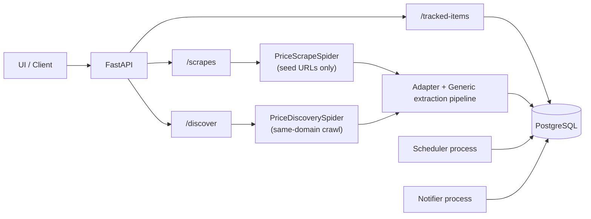

# Skrap Backend API

Backend service for product price extraction, URL discovery, item tracking, and periodic re-checking.

This README is written as a UI-facing API contract guide.
It documents every public endpoint, payload shape, validation rule, and the expected frontend usage flows.

## Table of Contents
1. [What This API Does](#what-this-api-does)
2. [Architecture at a Glance](#architecture-at-a-glance)
3. [Quick Start](#quick-start)
4. [API Conventions](#api-conventions)
5. [Endpoint Reference](#endpoint-reference)
6. [UI Integration Flows](#ui-integration-flows)
7. [Background Workers (Scheduler + Notifier)](#background-workers-scheduler--notifier)
8. [Data Model (Tracking Domain)](#data-model-tracking-domain)
9. [Configuration](#configuration)
10. [Operational Notes and Edge Cases](#operational-notes-and-edge-cases)
11. [Current Limitations](#current-limitations)

## What This API Does

Core capabilities:
- Scrape one or more product URLs and return normalized price data.
- Discover related product/pagination links from seed URLs, then scrape discovered URLs.
- Create tracked items from either:
  - a direct URL, or
  - a previous scrape result reference (`scrape_result_ref`) without re-scraping.
- Persist historical snapshots for tracked items.
- Periodically re-check active tracked items in a separate scheduler process.
- Emit alert events when price crosses below target and enqueue notification events.
- Deliver notifications through a notifier worker (MVP sender logs payloads).

Out of scope for now:
- Authentication/authorization.
- User management.
- Real provider integrations (email/SMS/push) beyond logging sender.

## Architecture at a Glance



Key implementation detail:
- `/api/v1/scrapes` already uses Scrapling Spider runtime (`PriceScrapeSpider`) but **does not follow links**.
- `/api/v1/discover` uses a separate discovery spider (`PriceDiscoverySpider`) that can follow same-domain pagination/product-like links.

## Quick Start

### 1. Install dependencies

```bash
./.venv/bin/pip install -r requirements.txt
```

### 2. Configure environment

Create `.env` in repo root (same folder as `README.md`):

```env
TRACKING_DATABASE_URL=postgresql://postgres.<project-ref>:<password>@aws-0-<region>.pooler.supabase.com:6543/postgres?sslmode=require
TRACKING_DB_POOL_MIN_SIZE=1
TRACKING_DB_POOL_MAX_SIZE=10
```

Notes:
- The app auto-loads `.env` from repository root.
- Fallback env resolution order for DB URL:
  1. `TRACKING_DATABASE_URL`
  2. `SUPABASE_DB_URL`
  3. `DATABASE_URL`
  4. default local postgres URL

### 3. Start API

```bash
./.venv/bin/uvicorn app.main:app --host 127.0.0.1 --port 8000 --reload
```

### 4. (Recommended) Start scheduler and notifier in separate terminals

```bash
./.venv/bin/python -m app.jobs.scheduler
```

```bash
./.venv/bin/python -m app.jobs.notifier
```

### 5. Open docs

- Swagger UI: [http://127.0.0.1:8000/docs](http://127.0.0.1:8000/docs)
- ReDoc: [http://127.0.0.1:8000/redoc](http://127.0.0.1:8000/redoc)

## API Conventions

### Base path
- Health endpoint: `/health`
- Versioned API prefix: `/api/v1` (configurable via `API_PREFIX`)

### Content type
- Request: `application/json`
- Response: `application/json` (except `DELETE /tracked-items/{item_id}` returns `204 No Content`)

### Request ID
- Middleware sets `X-Request-ID` response header for every request.
- Client may send `X-Request-ID`; if missing, server generates one.
- Most write responses include `request_id` in body.

### Time format
- ISO-8601 UTC (`...Z`) in payloads, e.g. `2026-04-17T16:26:31.058488Z`.

### Money format
- `amount` and `target_amount` are strings.
- Current implementation expects decimal-like strings (e.g. `"47999.00"`).
- UI should treat them as decimal text, not float.

### Tracking modes
Derived from `target_amount`:
- `target_amount == null` (or blank) => `tracking_mode: "monitor"`, `alerts_enabled: false`
- `target_amount != null` and non-empty => `tracking_mode: "alert"`, `alerts_enabled: true`

### Error model
- Validation/semantic errors: `422` with `{"detail": ...}`
- Missing resource: `404`
- Idempotency conflict: `409`
- Discovery-phase operational failure: `502`

## Endpoint Reference

## GET /health

Lightweight liveness check.

### Response

```json
{
  "status": "ok"
}
```

## GET /api/v1/sites

Returns supported site adapter keys.

### Response

```json
{
  "sites": [
    {"key": "akakce", "description": "Akakce adapter"},
    {"key": "generic", "description": "Generic extractor (fallback for any site)"},
    {"key": "newegg", "description": "Newegg adapter"}
  ]
}
```

UI usage:
- Populate site-filter chips/dropdown.
- Use `generic` as default safe option.

## POST /api/v1/scrapes

Batch scrape endpoint for direct URL list.

### Request body

| Field | Type | Required | Notes |
|---|---|---:|---|
| `urls` | `list[AnyHttpUrl]` | yes | min 1, max controlled by `SCRAPE_MAX_URLS` |
| `sites` | `list[str] \| null` | no | site filter; accepts `all` or `*` wildcard |
| `timeout_seconds` | `int \| null` | no | defaults to server default; must be within min/max bounds |
| `fetch_mode` | `"auto" \| "http" \| "dynamic" \| "stealth"` | no | default `auto` |

### Important behaviors
- URLs are de-duplicated preserving input order.
- `/scrapes` uses `PriceScrapeSpider` with seed URLs only (no link traversal).
- In `auto` mode, scraper starts with HTTP and can escalate to dynamic/stealth when signals indicate JS/protection.

### Example request

```json
{
  "urls": [
    "https://www.epey.com/akilli-telefonlar/huawei-pura-70.html"
  ],
  "sites": ["generic"],
  "timeout_seconds": 20,
  "fetch_mode": "auto"
}
```

### Response body

| Field | Type | Description |
|---|---|---|
| `request_id` | `str` | request correlation id |
| `scrape_ref` | `str \| null` | in-memory cache ref for this batch |
| `total_urls` | `int` | de-duplicated URL count |
| `success_count` | `int` | successful extraction count |
| `failure_count` | `int` | failed extraction count |
| `results` | `PriceResultResponse[]` | one result per de-duplicated input URL |

### `PriceResultResponse` fields

| Field | Type | Description |
|---|---|---|
| `result_ref` | `str \| null` | reference for track bootstrap without re-scrape |
| `url` | `str` | final URL used for this result |
| `success` | `bool` | extraction success flag |
| `product_id` | `str \| null` | stable product hash id for URL |
| `site_key` | `str \| null` | detected site key |
| `adapter_key` | `str \| null` | adapter that produced result (`generic`, `akakce`, etc.) |
| `amount` | `str \| null` | top listing amount |
| `currency` | `str \| null` | detected currency |
| `raw_text` | `str \| null` | raw extracted price text |
| `source` | `str \| null` | extraction source identifier |
| `product_name` | `str \| null` | extracted metadata |
| `brand` | `str \| null` | extracted metadata |
| `model` | `str \| null` | extracted metadata |
| `sku` | `str \| null` | extracted metadata |
| `gtin` | `str \| null` | extracted metadata |
| `image_url` | `str \| null` | extracted metadata |
| `canonical_url` | `str \| null` | canonicalized product URL when available |
| `availability` | `str \| null` | extracted stock/availability signal |
| `extracted_at` | `str \| null` | extraction timestamp |
| `listing_count` | `int` | number of normalized listings |
| `listings` | `PriceListingResponse[]` | full listing set |
| `error` | `str \| null` | failure reason when `success=false` |

### `PriceListingResponse` fields

| Field | Type | Description |
|---|---|---|
| `item_id` | `str` | stable item id derived from URL + candidate |
| `amount` | `str` | listing amount |
| `currency` | `str \| null` | listing currency |
| `raw_text` | `str` | raw listing text |
| `source` | `str` | extraction source |
| `seller` | `str \| null` | seller/merchant name |
| `listing_url` | `str \| null` | listing URL |

### UI recommendation
- Use `results[].result_ref` for immediate tracking CTA.
- Do not force user to re-enter URL after scraping.

## POST /api/v1/discover

Two-phase endpoint:
1. Discover URLs with spider crawl.
2. Scrape discovered URLs using same normalization pipeline as `/scrapes`.

### Request body

| Field | Type | Required | Notes |
|---|---|---:|---|
| `start_urls` | `list[AnyHttpUrl]` | yes | min 1, max same cap as `/scrapes` |
| `sites` | `list[str] \| null` | no | same site normalization semantics |
| `timeout_seconds` | `int \| null` | no | same timeout bound checks |
| `fetch_mode` | `"auto" \| "http" \| "dynamic" \| "stealth"` | no | applies in phase-2 scrape |
| `max_pages` | `int` | no | default 50, allowed 1..300 |
| `max_depth` | `int` | no | default 2, allowed 0..5 |

### Discovery behaviors
- Same-domain traversal only (derived from `start_urls`).
- Link heuristics follow:
  - pagination-like links,
  - product-like links.
- Denylist paths are skipped (cart, checkout, login, account, etc.).
- Blocked retries switch sid from `http` to lazy `stealth` session.

### Response body

| Field | Type | Description |
|---|---|---|
| `request_id` | `str` | request correlation id |
| `seed_count` | `int` | number of input seeds |
| `discovered_url_count` | `int` | discovered URL count before scrape dedupe |
| `discovered_urls` | `list[str]` | discovered canonical URLs (order preserved) |
| `discovery_stats` | object | crawl stats subset |
| `total_urls` | `int` | URLs sent to phase-2 scrape after de-duplication |
| `success_count` | `int` | phase-2 success count |
| `failure_count` | `int` | phase-2 failure count |
| `results` | `PriceResultResponse[]` | same model as `/scrapes` |

`discovery_stats` fields:
- `requests_count`
- `failed_requests_count`
- `blocked_requests_count`
- `offsite_requests_count`
- `elapsed_seconds`
- `sessions_requests_count`

### Example request

```json
{
  "start_urls": [
    "https://www.epey.com/akilli-telefonlar/huawei-pura-70.html"
  ],
  "sites": ["generic"],
  "timeout_seconds": 5,
  "fetch_mode": "auto",
  "max_pages": 50,
  "max_depth": 0
}
```

### UI guidance for product-tracking scenario
- If user wants "just this URL" behavior with spider runtime guarantees, use:
  - `max_depth: 0`
  - typically `max_pages: 1..5`
- If user wants exploration of category/listing pages, increase depth/pages.

### Failure mapping
- If discovery phase crashes: endpoint returns `502` with `discovery_failed: ...` detail.
- If phase-2 scrape crashes internally, service still returns partial failure `results` (status `200`).

## POST /api/v1/tracked-items

Create or refresh a tracked item.

Supports two bootstrap sources:
1. `url` (direct scrape now), or
2. `scrape_result_ref` (reuse recent `/scrapes` result from in-memory cache).

### Headers
- Optional: `Idempotency-Key: <string>`

### Request body

| Field | Type | Required | Notes |
|---|---|---:|---|
| `url` | `AnyHttpUrl \| null` | conditional | required when `scrape_result_ref` absent |
| `scrape_result_ref` | `str \| null` | conditional | required when `url` absent |
| `sites` | `list[str] \| null` | no | same site filter semantics |
| `timeout_seconds` | `int \| null` | no | same timeout bounds |
| `fetch_mode` | `"auto" \| "http" \| "dynamic" \| "stealth"` | no | default `auto` |
| `check_interval_minutes` | `int` | no | default 60, allowed 5..10080 |
| `target_amount` | `str \| null` | no | null/blank => monitor mode |

### Important behaviors
- If `scrape_result_ref` is provided, server resolves it from short-lived cache.
  - invalid/expired => `422 Invalid or expired scrape_result_ref`
- Upsert key is `source_url`.
  - existing row for URL is refreshed, not duplicated.
- On successful bootstrap, one snapshot is appended.
- With `Idempotency-Key`, same payload can be safely retried.
  - same key + different payload => `409`.

### Example (recommended after `/scrapes`)

```json
{
  "scrape_result_ref": "srf_scf_abc123_0",
  "check_interval_minutes": 60,
  "target_amount": "45000.00"
}
```

### Example (monitor-only item)

```json
{
  "url": "https://www.epey.com/akilli-telefonlar/huawei-pura-70.html",
  "check_interval_minutes": 60,
  "target_amount": null
}
```

### Response

```json
{
  "request_id": "...",
  "item": {
    "item_id": "trk_...",
    "source_url": "https://...",
    "canonical_url": "https://...",
    "product_id": "prd_...",
    "site_key": "generic",
    "adapter_key": "generic",
    "product_name": "...",
    "brand": "...",
    "model": null,
    "sku": null,
    "gtin": null,
    "image_url": "https://...",
    "availability": null,
    "currency": "TRY",
    "last_amount": "47999.00",
    "last_raw_text": "47999.00",
    "last_source": "json-ld[0]",
    "status": "active",
    "tracking_mode": "alert",
    "alerts_enabled": true,
    "check_interval_minutes": 60,
    "target_amount": "45000.00",
    "created_at": "...Z",
    "updated_at": "...Z",
    "last_checked_at": "...Z",
    "next_check_at": "...Z",
    "lease_until": null,
    "last_check_started_at": null,
    "last_check_finished_at": "...Z"
  }
}
```

## GET /api/v1/tracked-items

Returns tracked item list ordered by `updated_at DESC`.

### Response

```json
{
  "items": [
    {
      "item_id": "trk_...",
      "source_url": "https://...",
      "status": "active",
      "tracking_mode": "monitor",
      "alerts_enabled": false,
      "check_interval_minutes": 60,
      "target_amount": null,
      "next_check_at": "...Z",
      "last_checked_at": "...Z"
    }
  ]
}
```

UI usage:
- Main dashboard list.
- Derive badges from `status`, `tracking_mode`, `alerts_enabled`.

## GET /api/v1/tracked-items/{item_id}

Returns one tracked item + recent snapshots.

### Query params
- `snapshot_limit` (optional int)
  - if omitted: server default (`TRACKING_SNAPSHOT_DEFAULT_LIMIT`)
  - values `<1` are normalized to 1 internally

### Response fields
- `item`: same as list item shape.
- `recent_snapshots`: newest-first snapshot list.

`PriceSnapshotResponse` fields:
- `snapshot_id`
- `item_id`
- `checked_at`
- `success`
- `amount`
- `currency`
- `raw_text`
- `source`
- `error`

## PATCH /api/v1/tracked-items/{item_id}

Partial update of tracking configuration.
No scrape is triggered.

### Request body

| Field | Type | Notes |
|---|---|---|
| `status` | `"active" \| "paused" \| null` | pause/resume tracking |
| `check_interval_minutes` | `int \| null` | must be 5..10080 when provided |
| `target_amount` | `str \| null` | provide `null` to clear target and switch to monitor mode |

### Behavior notes
- Changing `target_amount` to `null` disables alert mode.
- If interval changes, `next_check_at` is recalculated from now.

### Example request

```json
{
  "status": "paused",
  "target_amount": null
}
```

## DELETE /api/v1/tracked-items/{item_id}

Deletes tracked item and related snapshots/check data via FK cascade.

### Response
- `204 No Content`

UI recommendation:
- Offer "Pause" and "Delete" separately.
- Delete is destructive history removal.

## UI Integration Flows

## Flow A: Simple one-off scrape (no tracking)
1. User enters one or many URLs.
2. UI calls `POST /api/v1/scrapes`.
3. Show `results[]` with price + metadata.

## Flow B: Scrape then track without re-scrape (recommended)
1. UI calls `POST /api/v1/scrapes`.
2. User chooses one result row.
3. UI calls `POST /api/v1/tracked-items` with `scrape_result_ref`.
4. Backend stores tracked item directly from cached result.

Why this is preferred:
- avoids duplicated network call,
- lower latency,
- consistent source payload from selected scrape row.

## Flow C: Direct track from URL
1. UI skips `/scrapes`.
2. UI calls `POST /api/v1/tracked-items` with `url`.
3. Backend performs immediate scrape and stores initial snapshot.

Use this when UI is in "quick track" mode and does not need preview list.

## Flow D: Discovery-driven exploration
1. UI calls `POST /api/v1/discover` with seed URL(s).
2. Backend discovers same-domain product/pagination links and scrapes them.
3. UI shows `discovered_urls` and `results`.
4. User picks one result and tracks it (via URL now; optionally via scrape flow/ref strategy).

For strict single-URL scenarios:
- use `max_depth=0` to avoid broader crawling.

## Flow E: Monitor mode vs alert mode

Monitor mode:
- `target_amount = null`
- scheduler still checks periodically,
- snapshots continue,
- no alert event generation.

Alert mode:
- `target_amount = "<decimal>"`
- scheduler emits alert when price crosses from `previous > target` to `current <= target`.

## Flow F: Pause / resume / stop tracking

Pause:
- `PATCH /tracked-items/{item_id}` with `{"status":"paused"}`
- paused items are not claimed by scheduler.

Resume:
- `PATCH /tracked-items/{item_id}` with `{"status":"active"}`

Stop/delete:
- `DELETE /tracked-items/{item_id}`

## Background Workers (Scheduler + Notifier)

These are not HTTP endpoints; they are internal processes.

## Scheduler (`python -m app.jobs.scheduler`)

Responsibilities:
- claim due active items with lease (`claim_due_items`),
- run scrape checks in bounded batches,
- write `tracking_check_runs`,
- update tracked item latest fields,
- append/update snapshots,
- compute `next_check_at` with jitter,
- emit `alert_events` and enqueue `notification_events`.

Execution semantics:
- at-least-once,
- lease-based reclaim on worker crash,
- dedupe key: `item_id + scheduled_for`.

## Notifier (`python -m app.jobs.notifier`)

Responsibilities:
- claim due notification outbox rows,
- send through sender adapter,
- finalize as `sent`, retry (`failed` + backoff), or `dead`.

Current sender:
- `LoggingNotificationSender` only (writes payload to logs).

## Data Model (Tracking Domain)

Primary tables:
- `tracked_items`
- `price_snapshots`
- `tracking_check_runs`
- `tracking_bootstrap_idempotency`
- `alert_events`
- `notification_events`

High-level relationships:
- one `tracked_item` -> many `price_snapshots`
- one `tracked_item` -> many `tracking_check_runs`
- one `alert_event` -> one/many `notification_events`

## Configuration

## Core API and scrape settings

| Variable | Default | Description |
|---|---:|---|
| `API_PREFIX` | `/api/v1` | versioned API prefix |
| `CORS_ALLOW_ORIGINS` | `*` | CORS list (`*` or comma-separated) |
| `SCRAPE_TIMEOUT_DEFAULT` | `30` | default timeout seconds |
| `SCRAPE_TIMEOUT_MIN` | `5` | min timeout accepted by API |
| `SCRAPE_TIMEOUT_MAX` | `120` | max timeout accepted by API |
| `SCRAPE_MAX_URLS` | `50` | max URLs per `/scrapes` or `/discover` request |
| `SCRAPE_CONCURRENCY` | `5` | scrape service worker concurrency |
| `SCRAPE_RESULT_CACHE_TTL_SECONDS` | `900` | TTL for `scrape_ref/result_ref` cache |
| `SCRAPE_RESULT_CACHE_MAX_BATCHES` | `500` | max cached scrape batches |

## Tracking DB settings

| Variable | Default | Description |
|---|---:|---|
| `TRACKING_DATABASE_URL` | local postgres URL | primary DB URL |
| `SUPABASE_DB_URL` | empty | fallback alias |
| `DATABASE_URL` | empty | fallback alias |
| `TRACKING_DB_POOL_MIN_SIZE` | `1` | psycopg pool minimum |
| `TRACKING_DB_POOL_MAX_SIZE` | `10` | psycopg pool maximum |

## Tracking behavior settings

| Variable | Default | Description |
|---|---:|---|
| `TRACKING_INTERVAL_DEFAULT_MINUTES` | `60` | default check interval |
| `TRACKING_INTERVAL_MIN_MINUTES` | `5` | min allowed interval |
| `TRACKING_INTERVAL_MAX_MINUTES` | `10080` | max allowed interval (7 days) |
| `TRACKING_SNAPSHOT_DEFAULT_LIMIT` | `20` | default detail snapshot limit |

## Scheduler settings

| Variable | Default | Description |
|---|---:|---|
| `SCHEDULER_POLL_SECONDS` | `10` | scheduler loop period |
| `SCHEDULER_CLAIM_BATCH_SIZE` | `250` | due items claimed per cycle |
| `SCHEDULER_MAX_INFLIGHT` | `64` | max concurrent scrape checks |
| `SCHEDULER_LEASE_SECONDS` | `180` | claim lease TTL |
| `SCHEDULER_JITTER_PERCENT` | `10` | next-check jitter |
| `SCHEDULER_ALERT_COOLDOWN_MINUTES` | `60` | min gap between repeated alerts per rule |
| `SCHEDULER_LEASE_OWNER` | auto-generated | optional explicit lease owner id |

## Notifier settings

| Variable | Default | Description |
|---|---:|---|
| `NOTIFIER_POLL_SECONDS` | `5` | notifier loop period |
| `NOTIFIER_CLAIM_BATCH_SIZE` | `100` | notifications claimed per cycle |
| `NOTIFIER_LEASE_SECONDS` | `120` | notification lease TTL |
| `NOTIFIER_MAX_ATTEMPTS` | `5` | max delivery attempts |
| `NOTIFIER_BASE_BACKOFF_SECONDS` | `30` | exponential backoff base |
| `NOTIFIER_BACKOFF_MAX_SECONDS` | `3600` | max retry delay |
| `NOTIFIER_RETRY_JITTER_PERCENT` | `10` | retry jitter |
| `NOTIFIER_LEASE_OWNER` | auto-generated | optional explicit lease owner id |

## Operational Notes and Edge Cases

### `scrape_result_ref` is in-memory and short-lived
- Cache is process-local and TTL-bound.
- After API process restart or TTL expiry, refs become invalid.
- UI should track soon after scrape if using this optimization.

### Discovery may return broad results
- Heuristics can include pages user may not consider relevant.
- For strict single-item behavior use `max_depth=0`.

### Tracking bootstrap can update existing tracked item
- If same `source_url` already tracked, bootstrap refreshes existing item and appends a new snapshot.
- UI should not assume every bootstrap creates a new `item_id`.

### Target amount UX
- Use explicit monitor/alert control in UI.
- Send `target_amount: null` for monitor mode.
- Do not send placeholder string values like `"string"`.

### Status transitions
- `active`: scheduler can claim/check item.
- `paused`: scheduler skips item until resumed.

### Idempotency best practice
- For create-track action, send `Idempotency-Key` from UI client.
- Reuse same key only for retried identical request payload.

## Current Limitations

- No auth: all endpoints are open in current MVP state.
- Notification sender is log-only (no email/SMS provider yet).
- No dedicated REST endpoints yet for alert/notification history exposure.
- No distributed queue yet; scheduler/notifier are DB-driven workers.

---

Additional docs:
- Architecture notes: `docs/backend-architecture-delivery.md`
- Postgres migration runbook: `docs/postgres-migration-runbook.md`
